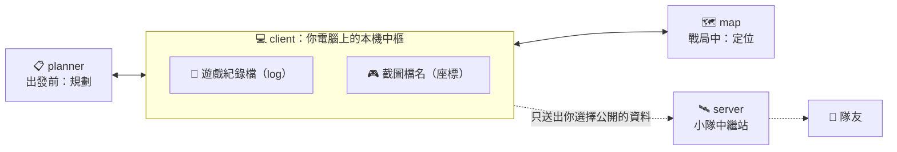

# 架構設計 (Architecture)

本文件記錄 Tarkov-WYA 的整體架構與設計決策。各 app 的細節見各自的 README。

## 1. 定位 (Positioning)

一般的公開資料型工具，提供的是完整、公開、人人相同的資訊，使用者要自己從中找出需要的部分，再對照自己的進度。

Tarkov-WYA 的出發點相反：**以使用者自己為中心**。先掌握「你進行到哪裡、身在哪裡、隊友在哪裡」，再把相關的資訊放到你眼前。

## 2. 系統組成 (Components)



| 元件 | 回答的問題 | 職責 | 不負責 |
|---|---|---|---|
| **planner** | 我進行到哪裡？這場該帶什麼？ | 任務進度、出發前清單、鑰匙管理、藏身處需求 | 任何位置相關資訊（含任務點） |
| **client** | — | 讀取資料來源、本機中樞、分享設定 | 畫面呈現 |
| **map** | 我和隊友在哪裡？任務點在哪？ | 自己與隊友的位置、任務點、路線與標記 | 任務進度的管理 |
| **server** | — | 在同一個房間內轉發各成員公開的資料 | 保存任何長期資料 |
| **protocol** | — | 所有元件之間的事件與資料格式規格 | — |
| **game-data** | — | 地圖、任務、物品、藏身處等通用遊戲資料 | 個人資料 |

### 邊界原則

- **planner 與 map 意義分開**：可以只用其中一個，也可以一起使用。兩者**不直接互相依賴**，只透過 client 交換資料。
- **一起使用時**：planner 把「這場要做的任務」（focus）送到 client，map 收到後只標出相關的任務點；planner 則依照你目前所在的地圖，列出相關的任務與物品。
- **任務點歸 map**：位置相關的一切都由 map 呈現；planner 只負責「做什麼、帶什麼」。

## 3. 資料來源 (Data Sources)

| 來源 | 取得方式 | 提供的資料 | 限制 |
|---|---|---|---|
| 截圖檔名 | client 定時觸發遊戲截圖，從檔名讀出座標後刪除截圖 | 玩家位置（X／Y／Z） | **每次截圖都會發出截圖音效**，可能干擾聽聲辨位 |
| 遊戲紀錄檔（log） | client 監聽遊戲寫在本機的 log | 任務狀態變化等（**待驗證**） | 只能取得工具開啟後發生的事件；細項進度可能讀不到 |
| 手動輸入 | 使用者在 planner 中修正或設定 | 舊進度、鑰匙、藏身處等級 | 需要使用者操作，UI 必須好用 |
| game-data | 從公開資料來源同步並快取 | 任務、物品、地圖、藏身處需求 | 授權需逐一確認 |
| 圖像辨識（未來） | 擷取需要的畫面區域並以 OCR 辨識 | 視需求而定 | 需支援英文、繁中、簡中；需留意效能 |

### 合規原則

- 不讀取遊戲記憶體、不注入、不修改任何遊戲檔案。
- 只使用遊戲本身提供的截圖功能，以及遊戲寫在本機的紀錄檔。
- 不使用 Battlestate Games 的商標、logo 或官方素材。

## 4. 分享模型 (Sharing Model)

所有資料都以**主題（topic）**為單位，發佈與訂閱完全分開：

| 主題 | 內容 | client：要不要公開 | planner／map：要不要看別人的 |
|---|---|---|---|
| `position` | 位置 | 使用者決定 | 使用者決定 |
| `progress.quests` | 任務進度 | 使用者決定 | 使用者決定 |
| `progress.hideout` | 藏身處 | 使用者決定 | 使用者決定 |
| `keys` | 鑰匙 | 使用者決定 | 使用者決定 |
| `annotations` | 路線與標記 | 使用者決定 | 使用者決定 |

- **沒有公開的主題，資料不會離開你的電腦**；server 只轉發各成員選擇公開的主題。
- 檢視端只篩選要顯示什麼，不影響別人。
- 每個人只能控制自己的追蹤與資料，別人無法操作。
- 標記（annotations）：房間內任何人都可以新增，只有作者可以刪除。
- 新增功能時只需要新增主題，分享機制不用改。

## 5. 使用模式 (Modes)

| 模式 | 說明 | 需要 server |
|---|---|---|
| 單人 | client 在本機提供資料給 planner／map | 否 |
| 開房 | 隊長架設 server 開一個房間 | 是 |
| 加入 | 連到隊長的房間，共享自己選擇公開的主題 | 是 |

planner 與 map 只跟本機的 client 溝通，不需要知道目前是單人還是多人模式。

## 6. 通訊協定 (Protocol)

- 規格以 JSON Schema 寫在 `packages/protocol`，是唯一的規格來源；再產生 C#（client、planner）與 TypeScript（map、server）的型別。
- 分成兩層：
  - **本機層**：planner／map ⇄ client
  - **中繼層**：client ⇄ server
- 連線時交換協定版本，版本不相容時提示使用者更新。
- server 在成員剛加入時送出房間的完整快照，讓晚加入的人也能看到現況。

## 7. 部署與執行環境 (Deployment)

### client

- **效能優先**：以事件驅動監聽資料夾變化，不定時輪詢；常駐背景時幾乎不耗資源。
- **貼合 Windows**：系統匣常駐、發佈成單一執行檔，讓使用者能快速開始使用。
- 圖像辨識只擷取需要的區域、只在需要時執行。

### planner

- Windows 桌面程式，支援置頂、多螢幕等桌面操作；不需要支援手機。

### map

- 網頁，可在手機或第二螢幕上使用。

### server

必須能部署在自己的電腦，或 Render、Google Cloud Run 這類註冊即可使用的平台。這類平台的限制與對應設計：

| 平台限制 | 設計對應 |
|---|---|
| 免費方案閒置會休眠，喚醒需要時間 | client 自動重試，並顯示「伺服器喚醒中」 |
| 沒有永久儲存空間 | 房間狀態只放在記憶體，資料以 client 為主 |
| 記憶體小 | 使用輕量的執行環境 |
| 由平台提供 HTTPS／WSS，透過 `PORT` 指定 port | 讀取 `PORT` 環境變數，提供健康檢查端點 |

## 8. 技術選擇 (Technology Choices)

| 元件 | 技術 | 理由 |
|---|---|---|
| client | C# · .NET 10 | 與 Windows 整合度最高（檔案監聽、按鍵輸入、內建 OCR、系統匣）；效能好，可發佈成單一執行檔；.NET 10 為長期支援版本 |
| planner | C# · WPF（.NET 10） | 桌面體驗完整；與 client 共用語言與資料模型；比 WinUI 3 成熟，打包發佈簡單 |
| map | Vue 3 · Vite · TypeScript | 延續既有經驗；可在手機上使用 |
| server | TypeScript · Node.js（附 Dockerfile） | 各大雲端平台原生支援、記憶體用量小；與 map 共用 TypeScript 型別 |
| protocol | JSON Schema | 與語言無關，可同時產生 C# 與 TypeScript 型別 |

## 9. 程式庫結構 (Repository Layout)

所有程式放在單一 monorepo，讓「意義分開」與「維護方便」同時成立：每個 app 各自獨立、有自己的 README；協定與遊戲資料只維護一份。

```
tarkov-wya/
├── apps/
│   ├── planner/     # 進度規劃
│   ├── client/      # 本機中樞
│   ├── map/         # 互動地圖（暫停）
│   └── server/      # 小隊中繼站（暫停）
├── packages/
│   ├── protocol/    # 事件與資料格式規格
│   └── game-data/   # 遊戲資料
└── docs/            # 架構設計與開發規劃
```

## 10. 授權 (License)

採用 **PolyForm Noncommercial 1.0.0**：

- 允許研究、學習與個人使用，**禁止商業使用**（販售、付費服務、向他人收費）。
- 內建不提供保證、不負擔責任的免責條款。
- 授權無法處理與遊戲公司之間的問題，這部分靠「合規原則」（第 3 節）降低風險。
