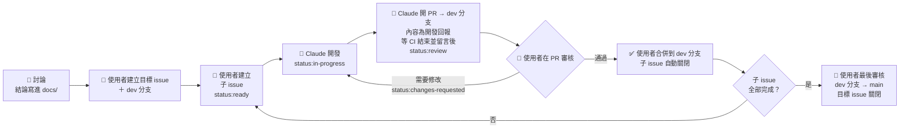
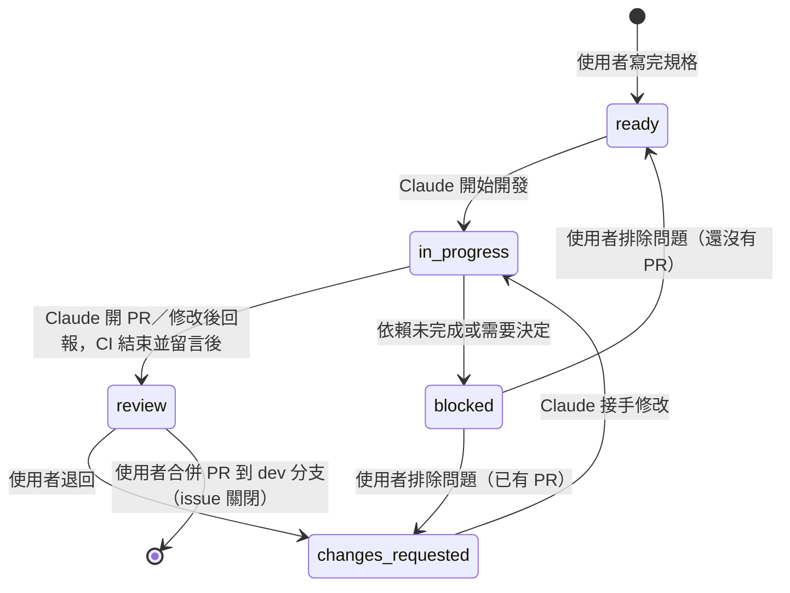

# 開發流程 (Workflow)

本專案以 **issue 驅動開發**：大的方向寫成「目標」issue，並開一個對應的 **dev 分支**；目標拆成多個子 issue 交給 Claude 開發，子 issue 的 PR 合併到 dev 分支；全部完成後，使用者把 dev 分支合併到 `main` 並關閉目標。決策依據見 [`decisions/0007`](decisions/0007-development-workflow.md)、[`decisions/0011`](decisions/0011-goals-and-status.md)、[`decisions/0012`](decisions/0012-traceable-development.md)。



| 步驟 | 誰 | 做什麼 |
|---|---|---|
| 1. 討論 | 使用者＋Claude | 討論開發方向；結論寫成 [決策紀錄](decisions) 或更新 `docs/` |
| 2. 建目標 | 使用者 | 用「🎯 目標」範本建立目標 issue，並從 `main` 開出對應的 dev 分支 |
| 3. 建子 issue | 使用者 | 在目標 issue 下建立子 issue，規格寫完後加上 `status:ready` |
| 4. 開發 | 另一個 Claude（agent team） | `/develop-issue <編號>`：從 dev 分支開出子分支開發，審查變更與 commit 規劃後依規劃 commit，完成後開 PR 到 dev 分支，PR 內容就是開發回報；等 CI 結束，在 PR 留言 CI 結果、在子 issue 留言完成條件確認 |
| 5. 審核 | 使用者 | 在 PR 頁面檢查回報、commit、差異與 CI；通過就合併到 dev 分支，需要修改就退回 |
| 6. 完成目標 | 使用者 | 子 issue 全部關閉後做最後審核，把 dev 分支合併到 `main`，目標 issue 隨之關閉 |

> Claude 可以開 PR，但**不能合併**：它的 token 沒有程式碼內容（Contents）的寫入權限，合併只有使用者能做。Claude 的 PR 一律以目標的 dev 分支為目標，**不會直接合併到 `main`**。

> 負責開發的 Claude **看不到**步驟 1 的討論，只能依據 issue 與 repo 中的文件。所以討論結論一定要寫進 `docs/`，issue 也要附上相關文件的連結。

## 1. 目標與子 issue

### 目標 issue

- 用「🎯 目標」範本建立，自動加上 `type:goal`
- 內容：目標、**開發分支**、背景、整體完成條件、不做的範圍、相關文件、子 issue 規劃、驗收方式
- 建立後**開出對應的 dev 分支**（見第 6 節），並確認範本的「開發分支」欄位與實際分支名稱相同
- **目標 issue 不交給 Claude 開發**，也不加狀態標籤；進度看 GitHub 顯示的子 issue 完成比例

### 子 issue

- 在目標 issue 頁面右側按 **Create sub-issue**（或 **Add existing issue**）建立，使用 ✨ 功能、🐛 錯誤回報、🧪 驗證實驗、🔧 工作項目範本
- 範本的「**上層目標**」欄位填目標 issue 的編號；Claude 會從目標 issue 讀取背景與**開發分支**
- 「**依賴**」欄位填必須先完成的子 issue；依賴還沒關閉時，Claude 不會開始開發
- 一個子 issue 只做一件事，大小以一次審核看得完為準

> **要交給 Claude 的 issue 必須有上層目標**，因為 Claude 要從目標取得 dev 分支。不屬於任何目標的小工作，請自行處理，或先建立一個目標。

### 寫好一個子 issue 的重點

開發者只看得到 issue 與 repo：

- **完成條件**：逐條列出，每一條都要能確認是否達成
- **不做的範圍**：明確寫出不處理的事，避免開發超出範圍
- **相關文件**：附上決策紀錄、架構章節與相關 issue 的連結
- **驗證方式**：寫出要執行的指令或要操作的畫面

## 2. 狀態標籤

每個子 issue 用**一個** `status:*` 標籤表示目前狀態，由使用者與 Claude 依下表更新：



| 標籤 | 意思 | 誰加上 | Claude 可以接手？ |
|---|---|---|---|
| （沒有狀態標籤） | 規格還在撰寫 | — | 否 |
| `status:ready` | 規格完成，可以開發 | 使用者 | **是** |
| `status:in-progress` | Claude 開發中 | Claude | 否（已被取走） |
| `status:review` | 已開 PR（或已在 PR 回報修改），CI 已結束，等待使用者審核 | Claude | 否 |
| `status:changes-requested` | 使用者退回，需要修改 | 使用者 | **是**（在原分支上修改） |
| `status:blocked` | 依賴未完成或需要使用者決定（附留言說明） | 任一方 | 否 |
| `status:paused` | 暫停中的範圍（例如 map、server） | 使用者 | 否 |
| issue 已關閉 | 完成（PR 已合併到 dev 分支）；關閉時自動移除 `status:*` 標籤 | 自動 | — |

**Claude 可以接手的 issue**：開啟中、不是目標 issue、帶有 `status:ready` 或 `status:changes-requested`、**有上層目標且目標的 dev 分支已存在**、「依賴」中的 issue 都已關閉。在 Claude Code 中用 `/next-issue` 可以列出目前可接手的 issue。

## 3. 怎麼看開發進度

| 想知道 | 看哪裡 |
|---|---|
| 某個目標完成多少 | 目標 issue 上的子 issue 完成比例 |
| 哪些等我審核 | [`label:status:review`](https://github.com/17-Tarkov-WYA/tarkov-wya/issues?q=is%3Aopen+label%3Astatus%3Areview) |
| 哪些正在開發 | [`label:status:in-progress`](https://github.com/17-Tarkov-WYA/tarkov-wya/issues?q=is%3Aopen+label%3Astatus%3Ain-progress) |
| 哪些卡住了 | [`label:status:blocked`](https://github.com/17-Tarkov-WYA/tarkov-wya/issues?q=is%3Aopen+label%3Astatus%3Ablocked) |
| 哪些可以交給 Claude | [`label:status:ready`](https://github.com/17-Tarkov-WYA/tarkov-wya/issues?q=is%3Aopen+label%3Astatus%3Aready) |
| 等我合併的 PR | [Pull requests](https://github.com/17-Tarkov-WYA/tarkov-wya/pulls) |
| 某個 issue 的分支與經過 | issue 留言「🤖 開始開發」；開發回報在 issue 連結的 PR 中 |
| 某個 issue 的完成條件驗證到哪裡 | 子 issue 留言「🤖 完成條件確認（Claude）」：逐條標示 ✅ 已完成／❌ 未完成／👤 需要使用者確認；退回修改後會有新的一則，以最新的為準 |
| 某個 PR 的 CI 結果 | PR 留言「🤖 CI 結果（Claude）」，或 PR 的 **Checks** 分頁 |

> 「🤖 完成條件確認」是 Claude 自己驗證的結果，**不代表使用者已驗收**；合併 PR 才是使用者的審核結果。issue 內容（使用者寫的原始需求）Claude 不會修改。

## 4. Labels

labels 由 [`.github/labels.yml`](../.github/labels.yml) 管理，push 到 main 後會自動同步到 GitHub。**新增或修改 label 請改這個檔案**，不要直接在網頁上改。

| 分類 | labels |
|---|---|
| 影響範圍 | `app:planner`、`app:client`、`app:map`、`app:server`、`pkg:protocol`、`pkg:game-data` |
| 類型 | `type:goal`、`type:feature`、`type:bug`、`type:experiment`、`type:chore`、`type:docs` |
| 狀態 | `status:ready`、`status:in-progress`、`status:review`、`status:changes-requested`、`status:blocked`、`status:paused` |

## 5. Milestones

milestone 對應 [`roadmap.md`](roadmap.md) 的開發階段，目標與子 issue 都歸屬一個階段：

| Milestone | 內容 |
|---|---|
| `1. 骨架` | planner 與 client 空白專案、solution、CI |
| `2. 驗證實驗` | 確認 log 與截圖能取得哪些資訊 |
| `3. protocol` | client ⇄ planner 的事件與資料格式 |
| `4. client` | 讀取 log、本機中樞、系統匣常駐 |
| `5. planner MVP` | 任務進度、出發前清單、鑰匙、藏身處 |

## 6. 分支與 commit

決策依據見 [`decisions/0009`](decisions/0009-development-conventions.md)、[`decisions/0011`](decisions/0011-goals-and-status.md)、[`decisions/0012`](decisions/0012-traceable-development.md)。

### 用語表

文件與指令中的分支一律用以下寫法：

| 寫法 | 指的是 | 命名 |
|---|---|---|
| `<dev 分支>` | 目標的 dev 分支 | `dev/<目標編號>-<簡短英文說明>` |
| `<子 issue 分支>` | 子 issue 分支 | `<類型>/<子 issue 編號>-<簡短英文說明>` |

### 分支結構

```
main ──────────────────────────────────────────●  ← 目標完成：dev 分支合併到 main
  └─ dev/1-skeleton ─────────●──────────●──────┘  ← 目標的開發分支（使用者建立）
      ├─ chore/2-solution ───┘          │         ← 子 issue 分支（Claude 建立）
      └─ chore/3-ci ────────────────────┘
```

| 分支 | 命名 | 誰建立 | 從哪裡開出 | 合併到 |
|---|---|---|---|---|
| `main` | — | — | — | — |
| **目標的 dev 分支** | `dev/<目標編號>-<簡短英文說明>` | 使用者 | `main` | `main`（目標完成時，使用者合併） |
| **子 issue 分支** | `<類型>/<子 issue 編號>-<簡短英文說明>` | Claude | 目標的 dev 分支 | 目標的 dev 分支（使用者合併） |

- 全部小寫英文、數字與 `-`，說明部分 2～5 個單字
- **建立 dev 分支**：在目標 issue 右側 **Development → Create a branch**，名稱填 `dev/<目標編號>-<說明>`、來源選 `main`。這樣建立的分支會顯示在 issue 上

子 issue 分支的類型：

| 類型 | 用於 | 對應的 issue 範本 | 範例 |
|---|---|---|---|
| `feat` | 新功能 | ✨ 功能 | `feat/12-quest-list` |
| `fix` | 修正錯誤 | 🐛 錯誤回報 | `fix/20-log-rotation` |
| `exp` | 驗證實驗 | 🧪 驗證實驗 | `exp/2-log-events` |
| `chore` | 建置與設定、CI／自動化、相依套件、其他 | 🔧 工作項目 | `chore/2-solution` |
| `test` | 只改測試 | 🔧 工作項目 | `test/25-log-parser` |
| `refactor` | 重構（行為不變） | 🔧 工作項目 | `refactor/30-hub-service` |
| `docs` | 只改文件 | 🔧 工作項目 | `docs/8-protocol-guide` |

🔧 工作項目依範本的「工作性質」欄位決定分支類型（選項括號內的類型）：

| 工作性質 | 分支類型 |
|---|---|
| 建置與設定、CI／自動化、相依套件、其他 | `chore` |
| 測試 | `test` |
| 重構 | `refactor` |
| 文件 | `docs` |

### 要用哪個分支（Claude）

| 情況 | 分支 |
|---|---|
| 第一次開發（`status:ready`） | 從**最新的 `origin/<dev 分支>`** 開新的子 issue 分支 |
| 退回修改（`status:changes-requested`） | 沿用 issue 留言「🤖 開始開發」中記錄的分支，**不開新分支** |
| 有依賴 | 依賴必須先合併到 dev 分支（issue 已關閉），所以一律從 dev 分支開；**不從其他子 issue 的分支開** |
| 目標的 dev 分支不存在、或沒有上層目標 | **不開始開發**，改為 `status:blocked` 並留言說明 |
| 開發中 dev 分支前進了 | 不自行 merge 或 rebase；有衝突時在回報中說明，由使用者處理 |

### commit 的拆分

每個 commit 都要有**針對性**（[`decisions/0012`](decisions/0012-traceable-development.md)；這是判斷的框架，不是固定分類）：

- 每個 commit 都應有一個明確的目的：只看該 commit 的變更與訊息，就能說明它做了什麼、為什麼做
- 不要將所有修改一股腦塞進同一個大雜燴 commit，也不要為了拆分而拆分，導致相關變更失去整體意義
- 類別相似、性質相同的變更可以聚合在同一個 commit；多條同類別的意見可以合併處理，「為什麼」完整列出每一條對應的來源
- 一條意見若涉及不同目的或性質的變更（例如同時涉及 UI 與 CI），可以依實際情況拆分為多個 commit
- 不要求一條意見對應一個 commit，也不要求每個 commit 僅對應一條意見
- 下表的性質保留為常見分組方式的參考框架，而非必須遵守的一對一分類：

| 性質 | 內容 | 類型 |
|---|---|---|
| 設定與建置 | 專案檔、相依套件、`.editorconfig`、CI、`.gitignore` 等 | `chore` |
| 程式邏輯 | 程式碼 | `feat`／`fix`／`refactor` |
| UI | XAML、版面、UI 文字 | 依情況用 `feat`／`fix`，摘要中寫出是 UI |
| 驗證實驗 | 驗證實驗的程式與紀錄 | `exp` |
| 測試 | 測試程式與範例資料 | `test` |
| 文件 | README、`docs/`、`CLAUDE.md`、`.claude/` 中的說明 | `docs` |

- **commit 規劃**：主要的 Claude 依當次變更決定分組，在 reviewer 審查前提出 commit 規劃（目的／標題、包含的檔案、分組理由、「為什麼」的來源、擬好的 commit 訊息）；以檔案為最小分組單位，同一個檔案不分配給不同 commit（因逐一驗證失敗而新增修正 commit 時不在此限）。reviewer 評估分組是否有針對性，可以要求調整、合併或拆分
- **先審查、再 commit**：第一次開發、退回修改、CI 失敗後的修正都是同一個流程——實作 → tester 驗證工作目錄整體變更 → reviewer 審查工作目錄變更與 commit 規劃 → 依審查意見修正 → 審查通過後依規劃建立 commit → tester 逐一驗證每個 commit → push。審查後的修正併入相關的變更，不另外為審查意見建立修正 commit
- **不規定先後順序**：順序依當下最適合的方式決定，但必須做到：
    - **每個 commit 單獨都能通過驗證**：建立 commit 之後，tester 逐一切到每個 commit（`git switch --detach <hash>`），執行格式檢查與受影響範圍的建置、測試並記錄結果，完成後切回子 issue 分支
        - 驗證失敗時：留言 tester 的結果 → 在工作目錄修正並擬定修正 commit 規劃 → reviewer 增量審查 → 新增修正 commit（不改寫原本的 commit）→ tester 驗證新增的修正 commit，並確認最後一個 commit 通過 → push
        - 失敗的 commit，以及它之後、修正之前因同一個原因失敗的 commit，在「## Commits」的「單獨驗證」欄標示「❌（由 <修正 commit> 修正）」；已標示失敗並由後續 commit 修正的歷史 commit，不阻擋通過
    - **排序有理由**：commit 規劃寫出順序與為什麼這樣排，寫進開發回報的「## Commits」（退回修改寫進修改回報）
    - **看得出頭尾**：每個 commit 內文加一行「順序：本輪第 k 個，基準 <hash>」。**每一次 push 就是一輪**：分支還沒 push 過時，基準是開分支時 dev 分支的 commit；之後的每一次 push（包含退回修改、CI 失敗後的修正），基準一律是 push 之前的 `origin/<子 issue 分支>`。開發回報、修改回報、CI 結果、完成條件確認都寫出範圍「基準 → 第一個 → 最後一個」與 compare 連結。commit 內文寫不了尾，尾以回報與留言為準
- 已建立的 commit 不改寫（不 `git commit --amend`、不 `git rebase`）

### commit 訊息

```
<類型>(<範圍>): <繁體中文摘要> (#<issue 編號>)

改了什麼：
- <檔案或模組>：<變更>

為什麼：
- <來源（5 類之一，見 decisions/0012「每一處變更都要有依據」）與原文>

順序：本輪第 <k> 個，基準 <hash>
```

- **類型**：同「子 issue 分支的類型」表（`feat`、`fix`、`exp`、`chore`、`test`、`refactor`、`docs`）
- **範圍**：`planner`、`client`、`map`、`server`、`protocol`、`game-data`、`repo`（跨多個範圍或整個 repo）、`docs`
- **摘要**：50 字以內，描述做了什麼，不加句號
- **內文必填**：「改了什麼」與「為什麼」兩段都要寫；「為什麼」必須引用可以查證的來源（子 issue／目標 issue、PR 留言、reviewer 審查結果、tester 驗證結果／CI 結果、repo 中的文件，共 5 類），不可以推測（[`decisions/0012`](decisions/0012-traceable-development.md)「每一處變更都要有依據」）
- 可以有多個 commit 對應同一個 issue

範例：

```
chore(repo): 建立 solution 與 planner、client 空白專案 (#2)

改了什麼：
- TarkovWYA.slnx：包含 planner、client 與測試專案
- global.json：指定 .NET SDK 10

為什麼：
- #2「完成條件」：「`dotnet build TarkovWYA.slnx -c Release` 成功，0 個警告、0 個錯誤」

順序：本輪第 1 個，基準 <開分支時 dev 分支的 hash>
```

```
fix(planner): 修正手動修正後進度被 log 覆蓋 (#21)

改了什麼：
- ProgressMerger：手動修正的項目不再被之後的 log 事件覆蓋

為什麼：
- PR 意見第 1 條（<留言連結>）：「手動修正應優先於 log」

順序：本輪第 1 個，基準 <push 之前 origin/子 issue 分支的 hash>
```

### 合併方式

所有 PR 一律用 **Create a merge commit** 合併（[`decisions/0012`](decisions/0012-traceable-development.md)）：

| PR | 合併方式 | 理由 |
|---|---|---|
| 子 issue 分支 → dev 分支 | **Create a merge commit** | 保留拆好的每個 commit，git 歷史看得出每一部分改了什麼、為什麼改 |
| dev 分支 → `main` | **Create a merge commit** | 保留每個子 issue 的合併點與 commit，`main` 上看得出目標由哪些工作組成 |

- `git log --first-parent` 只看合併點：在 dev 分支上一個子 issue 一個合併點，在 `main` 上一個目標一個合併點
- 不直接 commit 或 push 到 `main` 與 dev 分支，一律透過 PR 合併
- 同時進行多個目標、`main` 前進時：由使用者把 `main` 合併進 dev 分支後再繼續

### 子 issue 的自動關閉

GitHub 只在 PR 合併到**預設分支（`main`）**時，才會自動關閉 `Closes #N` 的 issue。子 issue 的 PR 合併到 dev 分支時，由工作流程 [`close-sub-issues.yml`](../.github/workflows/close-sub-issues.yml) 自動關閉 PR 內容中 `Closes #N` 的 issue，並留言註明合併到哪個分支。關閉時會一併移除該 issue 所有 `status:*` 標籤，其他標籤保留；已經關閉、或沒有 `status:*` 標籤的 issue 不受影響。

## 7. 開發與回報（Claude）

- 開發規則、回報格式與禁止事項都寫在 [`CLAUDE.md`](../CLAUDE.md)；環境設定見 [`claude-code.md`](claude-code.md)
- `/next-issue`：列出目前可以接手的 issue
- `/develop-issue <編號>`：檢查狀態、上層目標與依賴 → 留言「🤖 開始開發」並改為 `status:in-progress` → 從 dev 分支開出子分支開發 → reviewer 審查變更與 commit 規劃 → 依規劃 commit（第 6 節）→ tester 逐一驗證每個 commit → **開 PR 到 dev 分支**（內容為開發回報，第一行 `Closes #<編號>`，「## Commits」列出每個 commit）→ 等 CI 結束（`gh pr checks --watch`），在 PR 留言「🤖 CI 結果」→ 在子 issue 留言「🤖 完成條件確認」→ 改為 `status:review`
- 退回修改時：讀取 PR 上的意見 → 在原分支修改 → reviewer 審查變更與 commit 規劃 → 依規劃 commit（第 6 節）→ tester 逐一驗證每個 commit → push → 在 PR 留言「🤖 修改回報」→ 等 CI 結束並留言「🤖 CI 結果」→ 在子 issue **另留一則新的**「🤖 完成條件確認」→ 改為 `status:review`
- 完成條件的驗證結果寫在子 issue 的「🤖 完成條件確認」留言中：逐條原文引用 issue 的完成條件，標示 ✅／❌／👤；**不修改 issue 內容**，也不在目標 issue 留言
- 只在自己的子 issue 分支上開發，可以 push 自己的分支、開 PR；**不 push 到 main 或 dev 分支、不合併／關閉／核准 PR、不關閉 issue**

## 8. 審核與合併（使用者）

- 從 [Pull requests](https://github.com/17-Tarkov-WYA/tarkov-wya/pulls) 或 [`status:review`](https://github.com/17-Tarkov-WYA/tarkov-wya/issues?q=is%3Aopen+label%3Astatus%3Areview) 找到等待審核的工作
- 在 PR 頁面確認**目標分支是目標的 dev 分支**（不是 `main`），對照開發回報與子 issue 的「🤖 完成條件確認」留言，檢查 **Commits**（每個 commit 是否有明確的目的、內文是否寫出改了什麼與為什麼）、**Files changed** 與「🤖 CI 結果」留言
- **需要修改**：在 PR 的 **Conversation** 留言，**逐條寫出要改什麼**（行內留言可以當作補充，但要求本身請寫在留言中，Claude 才能完整讀到）；把子 issue 的標籤改成 `status:changes-requested`，再執行 `/develop-issue <編號>`
- **通過**：CI 通過後按 **Create a merge commit**（保留每個 commit）；子 issue 由工作流程自動關閉
- 合併後刪除子 issue 分支
- PR 是用你的 token 開的，作者會顯示為你的帳號，所以 GitHub 不允許你「核准」它；**合併就是你的審核結果**，不需要另外核准

## 9. 完成目標（使用者）

1. 目標 issue 的子 issue 全部關閉後，在 dev 分支上對照目標的「整體完成條件」與「驗收方式」做最後審核
2. 發現缺漏時新增子 issue，回到開發流程
3. 通過後開 PR：**dev 分支 → `main`**，內容寫 `Closes #<目標編號>`
4. CI 通過後按 **Create a merge commit**；目標 issue 自動關閉
5. **保留** dev 分支，不要刪除：ruleset 禁止刪除 `dev/**`，用來防止誤刪；保留的 dev 分支也是這個目標的紀錄

## 10. 設計決策

- 討論出的結論寫成 [決策紀錄](decisions)，格式見 [`decisions/README.md`](decisions/README.md)
- 推翻既有決策時新增一筆並把舊的標為「已取代」，不直接改寫舊紀錄

## 11. 隱私

- 遊戲紀錄檔、截圖等個人資料只放在 `experiments/data/`，已被 `.gitignore` 排除
- 貼到 issue 或 PR 之前，先移除帳號、玩家名稱等個人資訊
